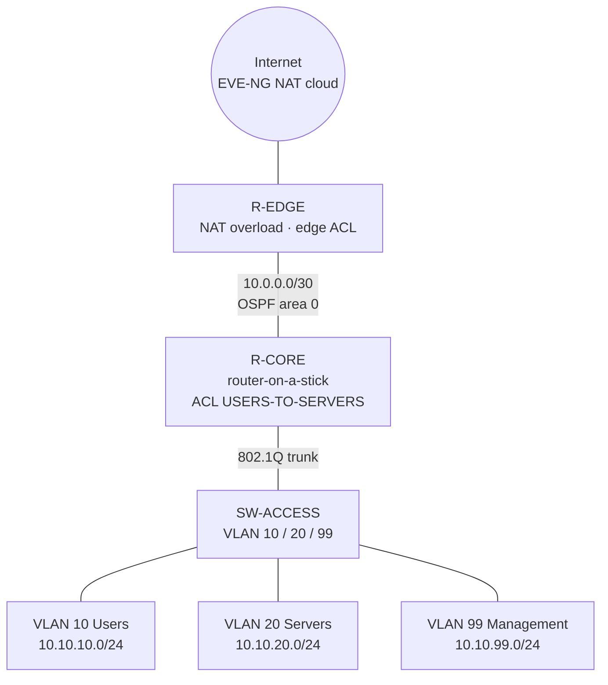

# Network Lab (EVE-NG)

A small enterprise network built and tested in EVE-NG on Cisco IOS: VLAN
segmentation, inter-VLAN routing, OSPF, NAT and ACLs, with the cleaned device
configurations.

## Context and objective

Network segmentation is one of the most effective security controls, and one
of the easiest to get wrong: an ACL on the wrong interface or in the wrong
direction silently does nothing, and a management plane reachable from user
VLANs undoes the rest.

The objective of this lab is to design a three-zone network (users, servers,
management), route between the zones, filter what users may reach on the
servers, give everything internet access through NAT, and validate each piece
with the matching `show` command before trusting it, the way a change is
validated in a lab before a production rollout.

## Architecture

| Device | Role | Platform |
| --- | --- | --- |
| R-EDGE | Internet edge: NAT overload, inbound edge ACL, default route into OSPF | Cisco IOS router |
| R-CORE | Inter-VLAN routing with sub-interfaces, OSPF, user-to-server ACL | Cisco IOS router |
| SW-ACCESS | VLANs, 802.1Q trunk, access ports, management SVI | Cisco IOSvL2 |

| VLAN | Name | Subnet | Gateway |
| --- | --- | --- | --- |
| 10 | Users | 10.10.10.0/24 | 10.10.10.1 |
| 20 | Servers | 10.10.20.0/24 | 10.10.20.1 |
| 99 | Management | 10.10.99.0/24 | 10.10.99.1 |
| - | Core to edge link | 10.0.0.0/30 | - |

## Technologies

- **EVE-NG**: network emulation
- **Cisco IOS** (routers) and **Cisco IOSvL2** (switch)
- VLANs, 802.1Q, OSPFv2, NAT/PAT, standard and extended ACLs

## What this project demonstrates

- Segmenting a network into users, servers and management zones.
- Router-on-a-stick inter-VLAN routing with 802.1Q sub-interfaces.
- Single-area OSPF with passive interfaces and a default route originated at
  the edge.
- PAT at the internet edge, and an inbound edge ACL that still lets DHCP, DNS
  and return traffic in.
- Extended ACL placement and ordering: placed close to the source, specific
  denies before permits, explicit final deny with logging.
- Restricting device management (SSH only, from the management VLAN only).

## Technical choices and trade-offs

| Choice | Why | Trade-off |
| --- | --- | --- |
| Router-on-a-stick on R-CORE instead of a layer 3 switch | Works with the IOS router and IOSvL2 images available in EVE-NG, and makes routing between VLANs explicit | All inter-VLAN traffic shares one physical link and the router CPU |
| OSPF single area 0 instead of static routes | New subnets are advertised automatically and the edge default route is propagated with `default-information originate` | More moving parts than two static routes for a network this small |
| Passive interfaces on the VLAN sub-interfaces | Subnets are advertised without sending OSPF hellos to hosts | None for user VLANs |
| Extended ACL inbound on the Users sub-interface | Traffic is filtered at the closest point to its source, before it crosses the router | Only covers traffic from VLAN 10; other zones need their own ACLs |
| PAT (overload) on the edge interface | One public address for every internal subnet | Inbound connections to internal hosts are not possible without static NAT |
| RFC 1918 sources not denied in `EDGE-IN` | The EVE-NG NAT cloud itself hands out a private address, so denying RFC 1918 would cut the lab off | Weaker anti-spoofing than on a real internet link (see limits) |

## Security

| Control | Device | Threat addressed | MITRE ATT&CK |
| --- | --- | --- | --- |
| `USERS-TO-SERVERS`: users reach servers on HTTP, HTTPS and ping only, SSH and RDP denied | R-CORE | Lateral movement from a compromised workstation | T1021.001 RDP, T1021.004 SSH |
| `EDGE-IN`: only DHCP, DNS replies, established TCP and echo replies allowed in, everything else dropped and logged | R-EDGE | Unsolicited inbound connections from the internet | T1190 Exploit Public-Facing Application (reduced exposure) |
| Loopback and `0.0.0.0/8` sources denied at the edge | R-EDGE | Spoofed source addresses | - |
| `MGMT-ONLY` on the VTY lines, SSH only, local login | SW-ACCESS | Management access from user VLANs, cleartext Telnet | T1021.004, T1040 Network Sniffing |
| Unused switch ports shut down | SW-ACCESS | Rogue device plugged into a free port | T1200 Hardware Additions |

**Publication risk:** the configurations are cleaned before being committed
(no passwords, secrets or SSH keys). A CI job fails if a password, secret,
SNMP community or key string ever appears in [`configs/`](configs).

## Installation and reproduction

1. In EVE-NG, add two Cisco IOS router nodes (R-EDGE, R-CORE), one IOSvL2
   switch (SW-ACCESS), test hosts in VLAN 10 and 20, and a NAT cloud.
2. Cable them as in the diagram: R-EDGE Gi0/0 to the NAT cloud, R-EDGE Gi0/1
   to R-CORE Gi0/1, R-CORE Gi0/0 to SW-ACCESS Gi0/0 (trunk), hosts on the
   access ports.
3. Paste the configurations from [`configs/`](configs):

   | File | Device |
   | --- | --- |
   | [`configs/R-EDGE.txt`](configs/R-EDGE.txt) | Edge router: NAT, edge ACL, OSPF |
   | [`configs/R-CORE.txt`](configs/R-CORE.txt) | Core router: sub-interfaces, OSPF, ACL |
   | [`configs/SW-ACCESS.txt`](configs/SW-ACCESS.txt) | Access switch: VLANs, trunk, management |

4. Add back what was removed for publication: an enable secret, a local user,
   `ip domain-name` and `crypto key generate rsa` for SSH.
5. Run the validation commands below.

## Results

Validation plan, one test per feature:

| Test | Command | Expected |
| --- | --- | --- |
| Inter-VLAN reachability | `ping 10.10.20.10` from a VLAN 10 host | Success |
| OSPF adjacency | `show ip ospf neighbor` | FULL between R-CORE and R-EDGE |
| OSPF routes learned | `show ip route ospf` | Edge sees the VLAN subnets via the core |
| NAT translations | `show ip nat translations` | Inside-local to inside-global entries |
| ACL enforcement | SSH or RDP from VLAN 10 to VLAN 20 | Blocked; HTTP and HTTPS allowed |
| ACL counters | `show access-lists USERS-TO-SERVERS` | Match counters increase on the deny lines |

Lessons from the build:

- An ACL applied on the wrong interface or in the wrong direction does not
  fail, it just never matches. Checking the match counters is the only proof
  it works.
- OSPF adjacencies that stay stuck are usually a mismatch in area, timers,
  MTU or network type, visible in `show ip ospf interface`.

## Limits and what I would do in production

- **No redundancy.** One edge router, one core router, one switch. Production
  would use redundant links and devices with a first-hop redundancy protocol
  (HSRP or VRRP).
- **Layer 2 not hardened.** The native VLAN is still VLAN 1 and DTP is not
  disabled on the trunk. Production would set an unused native VLAN, use
  `switchport nonegotiate`, and add DHCP snooping, dynamic ARP inspection and
  port security on access ports.
- **OSPF without authentication.** Any device on the core link could inject
  routes. Production would use OSPF authentication (HMAC-SHA).
- **Management plane only partly hardened.** VTY restrictions are shown on the
  switch only. Production devices would all use AAA (TACACS+ or RADIUS),
  SSHv2 only, NTP, SNMPv3, centralised syslog and login banners.
- **Edge anti-spoofing relaxed.** RFC 1918 sources are allowed in because of
  the EVE-NG NAT cloud. On a real internet link they would be denied, along
  with the other bogon ranges, and the edge would be a stateful firewall
  rather than a router ACL.
- **Only VLAN 10 is filtered.** Servers and management have no inbound ACL of
  their own. Production would apply a default-deny policy between every zone.
- **IPv4 only.** No IPv6, so no IPv6 first-hop security either.

## Next steps

- Add the `show` outputs and screenshots for each validation test
- Export the EVE-NG topology (`.unl`) so the lab can be imported directly
- Harden layer 2 (native VLAN, DTP, DHCP snooping, DAI)
- Add OSPF authentication and HSRP with a second core router

## License

[MIT](LICENSE)
